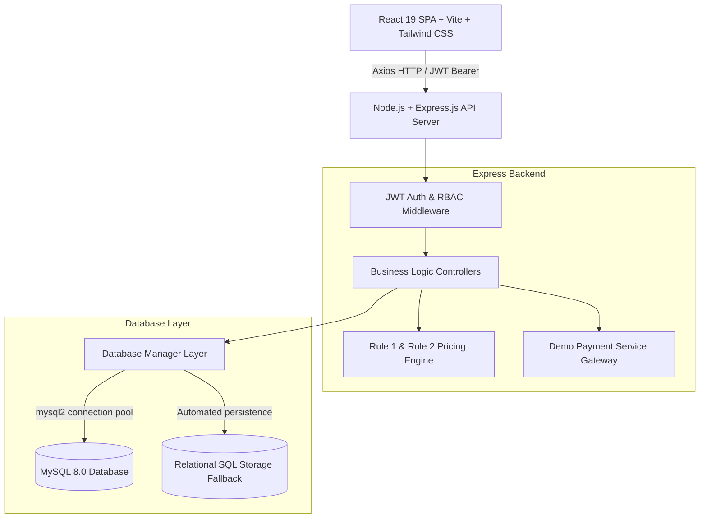
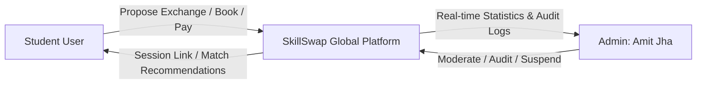
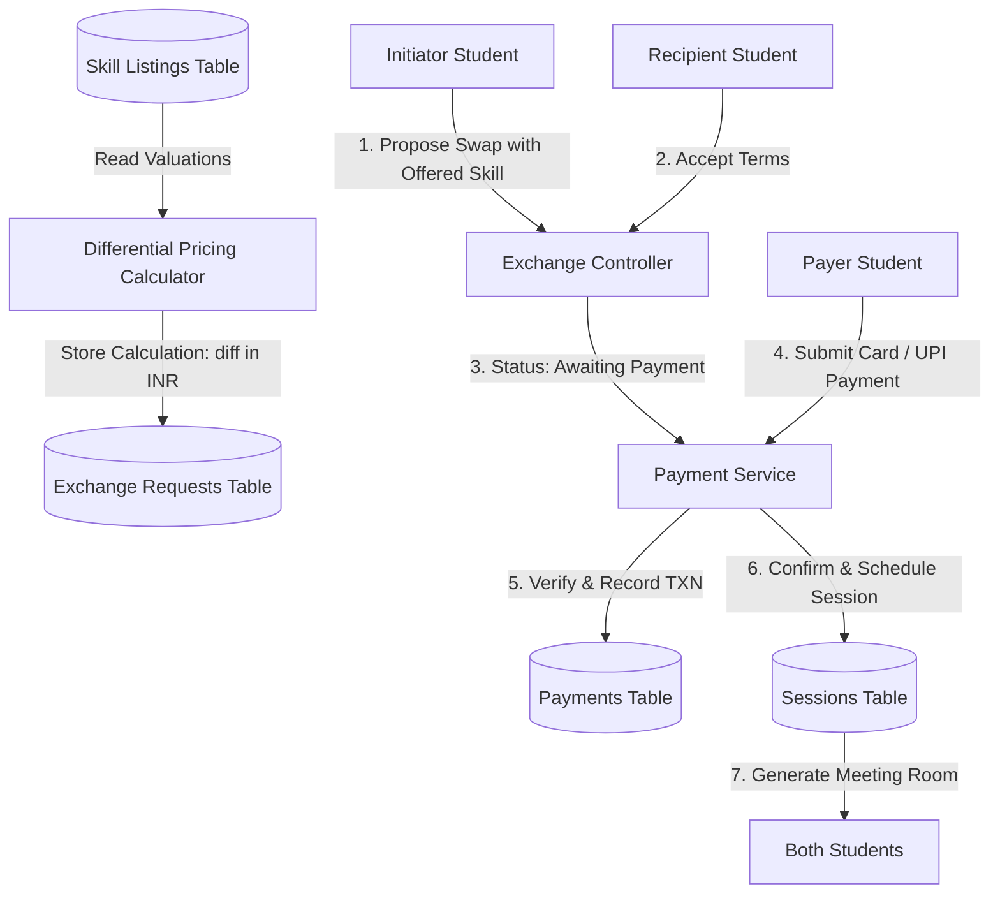
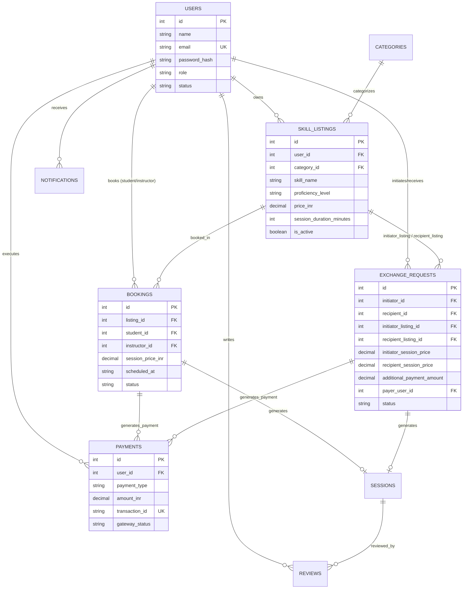

# SkillSwap Global — Software Requirements Specification & System Architecture
**Project:** SkillSwap Global  
**Tagline:** Learn Together. Share Skills. Grow Globally.  
**Program:** Master of Computer Applications (MCA) Final Year Project  
**Platform Administrator:** Amit Jha (`admin@skillswap.in`)

---

## 1. Project Overview & Problem Statement

In conventional higher education and collegiate environments, acquiring supplementary skills outside the university syllabus (such as modern web frameworks, system design, video editing, or interview rhetoric) typically requires expensive commercial tutoring courses or one-way private lessons. This poses an undue financial burden on students.

Conversely, thousands of students have already acquired proficiency in specific domains and are willing to mentor peers in exchange for reciprocal learning. **SkillSwap Global** introduces a structured, mathematical peer-to-peer barter platform where:
1. Equivalent skills are swapped completely for free.
2. Unequal expertise levels are balanced by calculating a transparent differential fee in Indian Rupees (INR ₹).
3. Students lacking skills to barter can directly book paid learning sessions.

---

## 2. Objectives and Scope

### Key Objectives:
- Democratize skill acquisition through peer reciprocity.
- Provide automated, backend-enforced mathematical exchange valuation.
- Eliminate fraudulent or off-platform payment claims through a verified payment status pipeline.
- Maintain an audit trail of sessions, ratings, and moderation reports for academic administration.

### Scope:
- Multi-role platform supporting Students and Administrators.
- Relational MySQL database schema with foreign key integrity.
- In-app messaging, real-time alert streams, and schedule collision prevention.
- Production-ready fallback relational SQL persistence for container environments.

---

## 3. Functional Requirements (FR)

- **FR-1 Authentication:** Register, authenticate via bcrypt and JWT Bearer tokens, maintain persistent sessions.
- **FR-2 Profile Management:** Maintain biographical information, location, languages, skills offered, skills wanted, and hourly availability.
- **FR-3 Skill Listing Management:** Create, read, update, deactivate, and delete skill listings with Indian Rupee session valuations and duration metadata.
- **FR-4 Rule 1 Equal-Level Exchange:** Propose and confirm 100% free exchanges when session values are equivalent (`diff = 0`).
- **FR-5 Rule 2 Unequal-Level Exchange:** Automatically calculate:
  $$\text{Additional Payment} = \max(0, \text{Higher Session Price} - \text{Lower Session Price})$$
  and enforce settlement via the verified demo payment gateway before session confirmation.
- **FR-6 Rule 3 Direct Paid Learning:** Permit students with zero offered skills to book any mentor's listed price in INR directly.
- **FR-7 Session Management:** Prevent double bookings, assign secure virtual room links, and track completion states.
- **FR-8 Peer Reviews:** Permit 1-5 star reviews strictly upon completed sessions; prevent duplicate submissions.
- **FR-9 In-App Messaging:** Secure student-to-student direct messaging.
- **FR-10 Algorithmic Matching:** Recommend compatible exchange partners based on wants vs. offers with human-readable rationale without external AI reliance.
- **FR-11 Admin Portal:** Dedicated dashboard for Amit Jha to inspect real-time metrics, moderate listings, toggle account suspensions, and audit financial transactions.

---

## 4. Non-Functional Requirements (NFR)

- **Performance:** Response times under 150ms for core catalog queries.
- **Security:** Passwords hashed with 10-round bcrypt salt; parameterized SQL queries to prevent SQL injection; JWT validation on all private routes.
- **Relational Integrity:** Foreign keys with `ON DELETE CASCADE` or `ON DELETE SET NULL` preventing orphan records; numeric monetary values stored strictly using `DECIMAL(10,2)`.
- **Usability:** Responsive layout optimized for desktop, tablet, and mobile with Indian Rupee (₹) formatting.

---

## 5. Software Development Life Cycle (SDLC) Methodology

SkillSwap Global was architected following the **Agile Iterative Waterfall Hybrid Model**:
1. **Requirements & Mathematical Modeling:** Formulation of Barter Rules 1, 2, and 3.
2. **Database Schema Design & Normalization:** 3NF relational normalization across 15 entities.
3. **Backend API Engineering:** Node.js, Express.js controllers, JWT middleware.
4. **Frontend Architecture:** Component modularity in React 19, Tailwind CSS design system.
5. **Integration & Acceptance Verification:** End-to-end execution of student swaps and admin workflows.

---

## 6. System Architecture Diagram

---

## 7. Data Flow Diagrams (DFD)

### Level 0 DFD (Context Diagram)

### Level 1 DFD (Exchange & Payment Flow)

---

## 8. Entity Relationship Diagram (ERD)

